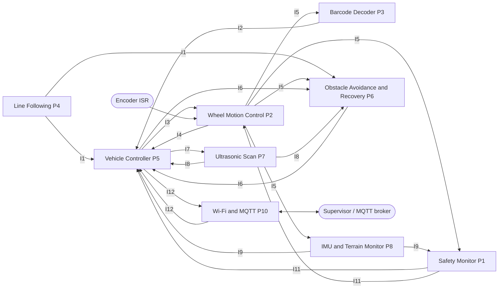
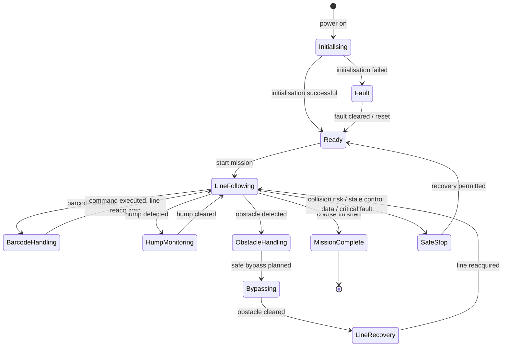
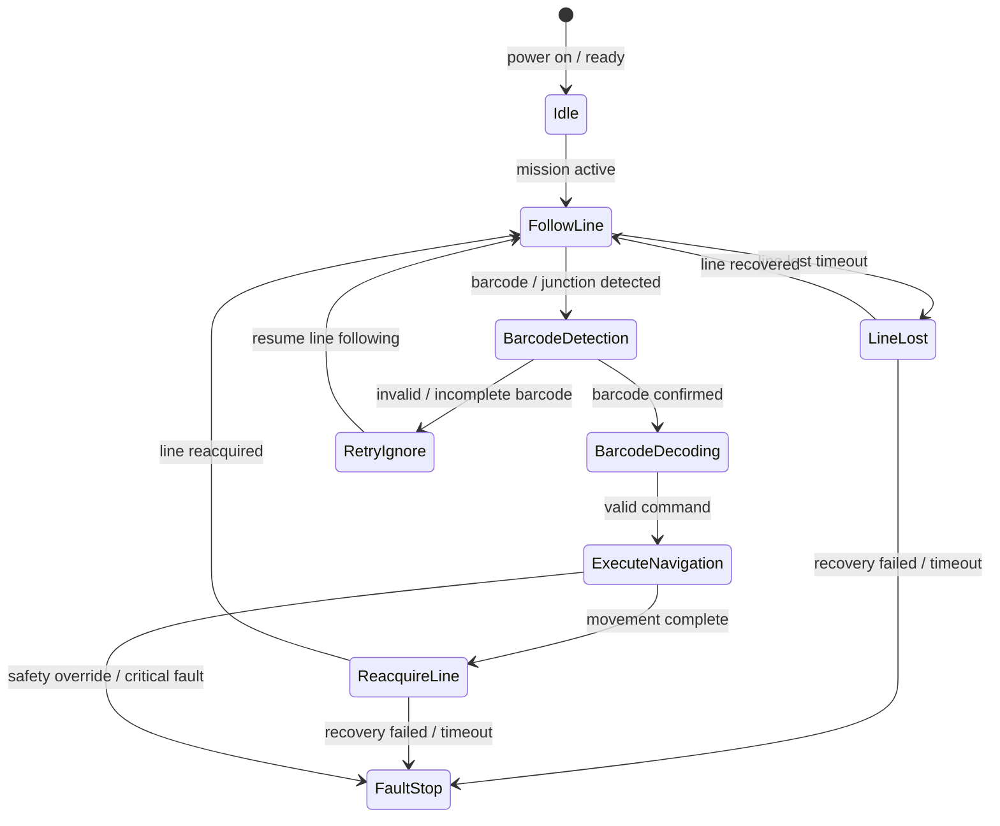
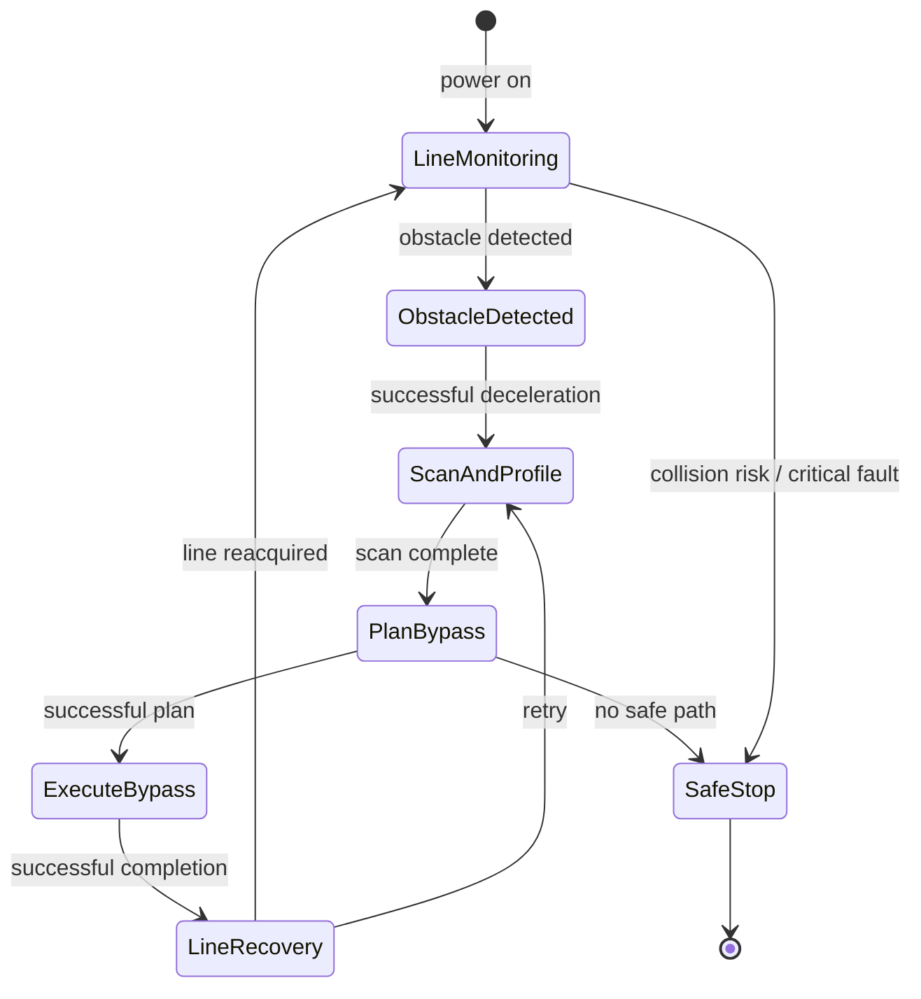
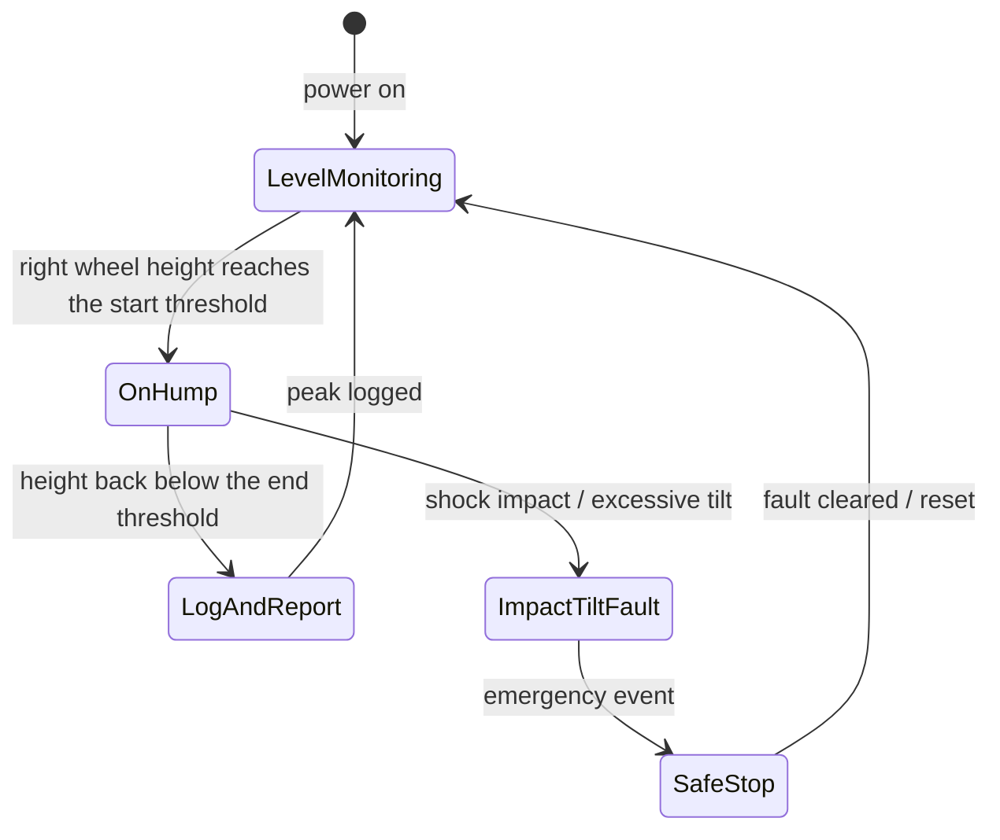

# System Architecture

The design agreed at the Week 6 design review, with later changes noted where they apply: tasks, ownership, interfaces and statecharts. Requirement IDs (FR/NFR/A) refer to [PROJECT_BRIEF.md](PROJECT_BRIEF.md#team-requirements).

## Design rules

These decisions were frozen at the review. Changing one means updating this document.

1. **Only Wheel Motion Control writes motor outputs.** Every other task requests motion; none drives a motor pin.
2. **Each hardware device has exactly one owning task.** Others get its data through an interface.
3. **Safety Monitor has the highest priority and can stop the car on its own**, bypassing the Vehicle Controller.
4. **Telemetry runs below everything else**, so a network delay can never hold up navigation or motor control.
5. **Encoder edges are captured by interrupt**, not by a periodic task.
6. **The ultrasonic scanner scans on request**, not every cycle.
7. **No unbounded queues and no runtime allocation in control paths** (NFR7).
8. **Integrate early.** Interfaces are tested before the subsystems behind them are finished.

## Layers

| Layer         | Contents                                                                     |
| ------------- | ---------------------------------------------------------------------------- |
| Sensing       | Line IR, barcode IR, wheel encoders, IMU, ultrasonic                         |
| Control       | Motion control, line following, obstacle avoidance, navigation logic, safety |
| Communication | Wi-Fi, MQTT, telemetry                                                       |

## Tasks

`P1` is the highest priority. µT-Kernel uses the same convention (a lower number runs first), but these are an order, not `itskpri` values: priorities 1 to 4 belong to the kernel's own tasks (USB console 3, Wi-Fi 4), and each subsystem's actual priorities come from its band in `TEAM.md` section 4.

| Pri | Task                            | Purpose                                                                              | Trigger                        | Buddy |
| --- | ------------------------------- | ------------------------------------------------------------------------------------ | ------------------------------ | ----- |
| P1  | Safety Monitor                  | Stop on stale control data, a critical fault or an explicit stop. Holds the latched stop | 5 ms + events                  | All   |
| P2  | Wheel Motion Control            | Sole motor writer. Per-wheel PID, odometry, encoder-based turns                      | 10 ms + stop wake              | 2     |
| P3  | Barcode Decoder                 | Decode the auxiliary IR samples and validate LEFT / RIGHT / STRAIGHT / UTURN         | 10 ms                          | 3     |
| P4  | Line Following                  | Line error and junction detection from two digital IR sensors                        | 10 ms                          | 3     |
| P5  | Vehicle Controller              | Mission state machine and arbiter of normal motion                                   | Events + 10 ms                 | All   |
| P6  | Obstacle Avoidance and Recovery | Plan the bypass and the return to the line                                           | Events, ≥ 20 ms between steps  | 5     |
| P7  | Ultrasonic Scan                 | Drive the servo and HC-SR04 through forward, coarse and fine scans                   | 5 ms service                   | 5     |
| P8  | IMU and Terrain Monitor         | Pitch, motion class, hump height estimate, turn-rate estimate                        | 10 ms                          | 4     |
| P10 | Wi-Fi and MQTT Telemetry        | Telemetry, heartbeat, supervisor commands                                            | 10 ms service                  | 1     |
| ISR | Encoder ISR                     | Count encoder edges for Wheel Motion Control                                         | GPIO edge                      | 2     |

The periods are design targets, not measurements. P9 is left free.

> [!NOTE]
> `tk_dly_tsk` cannot wait for less than one kernel tick (`CNF_TIMER_PERIOD` in `config/config.h`, 10 ms as shipped). The 5 ms periods above need the tick lowered to 1 ms, as the review assumes; on the 10 ms tick the Safety Monitor runs every 10 ms.

### Barcode acquisition

The ADC samples the barcode sensor (ADC0) at 2 ksample/s, paced by the ADC clock divider and moved by one DMA channel into a 256-sample (128 ms) ring that wraps by itself. Every 10 ms the task takes the samples written since its last read, about 20. A task that falls more than 128 ms behind loses the oldest samples. Bar widths are measured against encoder distance (I5), never against task wake-ups, so speed changes do not distort them.

At 0.20 m/s and a 3 mm narrow bar this gives about 30 samples per narrow bar.

### Hardware ownership

| Hardware                           | Owner                                     |
| ---------------------------------- | ----------------------------------------- |
| Motor driver outputs (GP8 to GP11) | Wheel Motion Control                      |
| Wheel encoders                     | Encoder ISR, feeding Wheel Motion Control |
| Left and right line IR sensors     | Line Following                            |
| Auxiliary barcode IR sensor (ADC0) | Barcode Decoder                           |
| GY-511 IMU (I2C0)                  | IMU and Terrain Monitor                   |
| HC-SR04 and SG90 servo             | Ultrasonic Scan                           |
| Pico W radio and network stack     | Wi-Fi and MQTT Telemetry                  |

The Vehicle Controller coordinates the others and owns no hardware. Pin numbers are in [HARDWARE.md](HARDWARE.md#pin-map).

The kernel port adds its own constraints: the radio, lwIP and MQTT belong to the kernel's Wi-Fi service task on processor 1 (physical core 0), and each peripheral block is driven by exactly one owning task. Peripheral owners are recorded in `TEAM.md` section 3.

## Interfaces

Not drawn: every task reports health to the Safety Monitor over I10.

| ID  | From → To                                                                       | Carries                                                                               |
| --- | ------------------------------------------------------------------------------- | ------------------------------------------------------------------------------------- |
| I1  | Line Following → Vehicle Controller, Obstacle Avoidance                         | Line bits, junction flag, validity                                                    |
| I2  | Barcode Decoder → Vehicle Controller                                            | Validated command, encounter ID, capture pose                                         |
| I3  | Vehicle Controller → Wheel Motion Control                                       | Motion target: ID, mode, wheel speed / distance / angle, limits, expiry               |
| I4  | Wheel Motion Control → Vehicle Controller                                       | Motion status: `RUNNING`, `COMPLETE`, `FAILED`, `CANCELLED`                           |
| I5  | Wheel Motion Control → Barcode Decoder, IMU, Obstacle Avoidance, Safety Monitor | Odometry snapshot: counts, speed, distance, yaw estimate                              |
| I6  | Vehicle Controller ↔ Obstacle Avoidance                                         | Activate / cancel one way; proposed bypass, progress and faults the other             |
| I7  | Vehicle Controller → Ultrasonic Scan                                            | Scan request: `FORWARD`, `COARSE` or `FINE`                                           |
| I8  | Ultrasonic Scan → Vehicle Controller, Obstacle Avoidance                        | Range or profile, angle, validity                                                     |
| I9  | IMU and Terrain Monitor → Vehicle Controller, Safety Monitor                    | Pitch, turn rate, hump height, impact / tilt fault                                    |
| I10 | Every task → Safety Monitor                                                     | Health, data freshness, faults                                                        |
| I11 | Safety Monitor → Vehicle Controller, Wheel Motion Control                       | Latched stop, cause, generation                                                       |
| I12 | Wi-Fi and MQTT ↔ Vehicle Controller                                             | `START` / `STOP` / `RESET` from the supervisor; telemetry, heartbeat and events to it |

Notes:

- I3 is a one-slot mailbox: a new target replaces the old one, and the Vehicle Controller must renew it before it expires, otherwise Wheel Motion Control brakes.
- Collision risk belongs to Obstacle Avoidance, which brakes on the first forward reading within 350 mm. The Safety Monitor does not read I8: a range backstop could never act before avoidance, which brakes on the same reading, and only avoidance requests readings. An IMU fault on I9 asserts the I11 stop.
- A validated `STOP` from the supervisor also raises a safety request on I11, so it latches like any other stop.
- The stop on I11 carries a generation number. Motion requests issued before the stop are stale and must be discarded (FR11).
- The supervisor may only start, stop and reset. It never steers or sets speed (FR1).
- Each interface needs a fixed message layout and one kernel object to carry it (message buffer, event flag or mailbox), agreed between the two owners before integrating.

## System statechart

Barcode Handling, Obstacle Handling, Bypassing and Line Recovery also drop to Safe Stop on a collision risk or critical fault.

| State             | What happens                                                                                                          |
| ----------------- | --------------------------------------------------------------------------------------------------------------------- |
| Initialising      | Create tasks; configure GPIO, motors, encoders and Wi-Fi; initialise and calibrate the IR, IMU and ultrasonic sensors |
| Ready             | System healthy. Wait for the start condition, keep Wi-Fi up, publish heartbeat                                        |
| Line Following    | Follow the line, hold speed and heading from the encoders, watch for junctions, barcodes, humps and obstacles         |
| Barcode Handling  | Read and decode the barcode, generate the navigation command, execute the turn                                        |
| Hump Monitoring   | Read the IMU, detect climb and descent, estimate height, record the highest peak                                      |
| Obstacle Handling | Stop or slow, scan with the servo-mounted sensor, build the obstacle profile, plan a bypass                           |
| Bypassing         | Execute the avoidance manoeuvre while keeping clearance                                                               |
| Line Recovery     | Search for the original line, reacquire it, realign heading                                                           |
| Safe Stop         | Motors stopped immediately. Wait for a recovery command                                                               |
| Fault             | A subsystem failed, a sensor is missing, or initialisation errored                                                    |
| Mission Complete  | Course finished: stop motors, report final telemetry including the maximum hump estimate                              |

The Vehicle Controller folds Hump Monitoring, Line Recovery and Mission Complete into its other states ([VEHICLE_CONTROLLER.md](VEHICLE_CONTROLLER.md#states)).

Safe Stop is latched. Leaving it requires the fault to clear or a reset, followed by a new Start (FR11). Mission Complete is entered only on a validated course-finish event (FR12).

## Subsystem statecharts

### Line following and barcode navigation

Tasks: Line Following, Barcode Decoder, Vehicle Controller, Wheel Motion Control.

- **Follow Line** reads the left and right IR sensors, computes the steering correction, and watches for junctions and barcode regions.
- **Barcode Detection** starts sampling the auxiliary sensor; **Barcode Decoding** turns the black/white pattern into a command.
- An invalid or incomplete barcode is rejected and line following resumes. An unvalidated command is never executed.
- **Execute Navigation** performs the left, right, straight or U-turn manoeuvre with encoder-based motion.
- **Line Lost** attempts a search, slowing or stopping as needed. If recovery times out the car stops and waits for reset or safety clearance.

### Obstacle detection and avoidance

Tasks: Ultrasonic Scan, Obstacle Avoidance and Recovery, Vehicle Controller, Wheel Motion Control, Safety Monitor.

Obstacle Detected, Scan and Profile, and Execute Bypass also abort to Safe Stop on a collision risk or critical fault.

- **Obstacle Detected** slows or stops the car before anything else.
- **Scan and Profile** commands a servo angle, triggers the HC-SR04, computes the range, and repeats across the sweep: coarse first, then fine around the sectors where something was seen.
- The resulting profile is location, width, closest point, left clearance and right clearance.
- **Plan Bypass** picks the direction with the least route deviation and produces speed and distance targets.
- **Execute Bypass** runs those targets through Wheel Motion Control while clearance is monitored.
- Scans happen only with the car stopped; while moving, the sensor faces forward.
- Reverse is disabled: nothing verifies clearance behind the car. Replanning is bounded, and no safe forward route means Safe Stop (FR7).

### IMU terrain monitoring

Tasks: IMU and Terrain Monitor, Vehicle Controller, Safety Monitor.

Impact or excessive tilt is checked in every monitoring state, not only the one drawn.

- **Level Monitoring** calibrates the start-surface baseline, then tracks filtered pitch, roll and acceleration.
- Humps pass under the right wheel only; the left side carries the barcode sensors. The car rests on three points (two drive wheels and a front caster), so it tips about the line from the left wheel to the caster, and the right wheel's height is the track width × sin(roll). No encoder travel is needed (FR5).
- **On Hump** tracks the highest height until the wheel is back on flat ground.
- **Log and Report** updates the run maximum and queues the hump event for telemetry.
- The task also publishes one current motion class, highest first: impact, climbing or descending a hump, accelerating or braking, steady. Steady covers both parked and cruising: the accelerometer cannot tell them apart, so stationary and turning need odometry (I5).
- Impact is a jump of more than 800 mg in X or Y away from its smoothed value; excessive tilt is pitch or roll beyond 25° for 500 ms. Both latch. These replace the review's 2.5 g and 30° for 100 ms; at ±2 g full scale the sensor cannot report 2.5 g.
- A start threshold that must hold for a minimum time, above a lower end threshold, on low-pass filtered data, rejects vibration and jolts. Turning pushes sideways on the sensor and looks like roll, so cornering is the main source of false humps (A4).

The review's diagram mentions gyro data. The GY-511 has no gyroscope, so everything here comes from the accelerometer, and turn rate comes from odometry.

## Telemetry

Topics and payloads are in [TELEMETRY.md](TELEMETRY.md). The brief expects telemetry to cover at least:

- current robot state
- motor speed and encoder counts
- line sensor status
- barcode detected
- hump measurements
- obstacle scan results
- distance travelled
- heartbeat and connection status

Publish only useful state and events. Payloads are compact binary, per [DATA_REPRESENTATION.md](DATA_REPRESENTATION.md); this replaces the review's JSON message design. Telemetry bandwidth is measured under NFR7.

The kernel port ships an MQTT client (`lib/liblwip/sysdepend/pico_rp2040/mqtt_utk.c`, built with `NET=lwip MQTT=1`) that runs inside the kernel's Wi-Fi service task. The Telemetry task does not call it directly: it hands messages to the service through a kernel object, as described in `TEAM.md` section 3.

## Values set by measurement

The design does not fix these. They come from tests on the real car and track, and belong with the owning subsystem's calibration data (NFR8).

| Value | Established by |
| --- | --- |
| Task periods and priorities | Execution-time and timing measurements |
| Barcode sampling rate | Measured bar width and car speed |
| PID constants | Experimental tuning |
| IR thresholds and barcode timing | Calibration on the real track |
| Hump-height estimation error | Humps of known height (A4) |
| Ultrasonic profile error | Objects at known distance and width (A5) |
