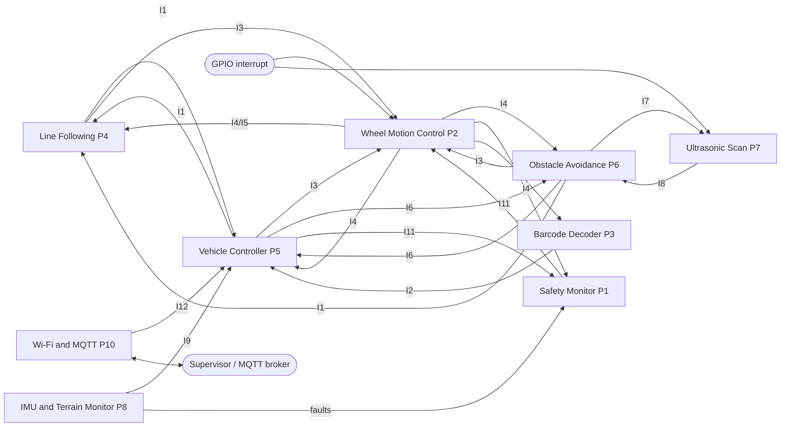
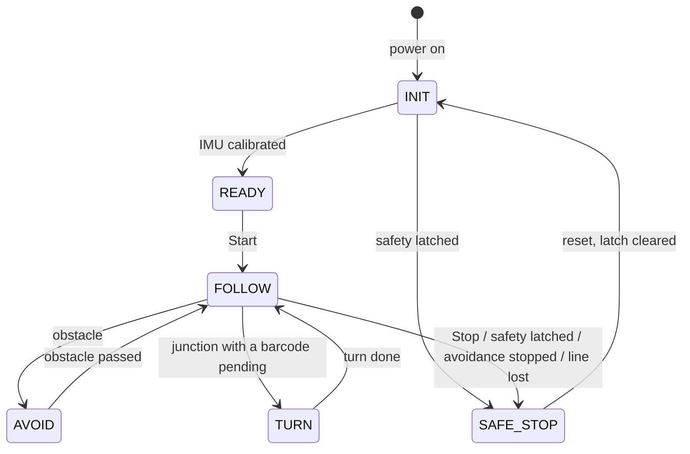
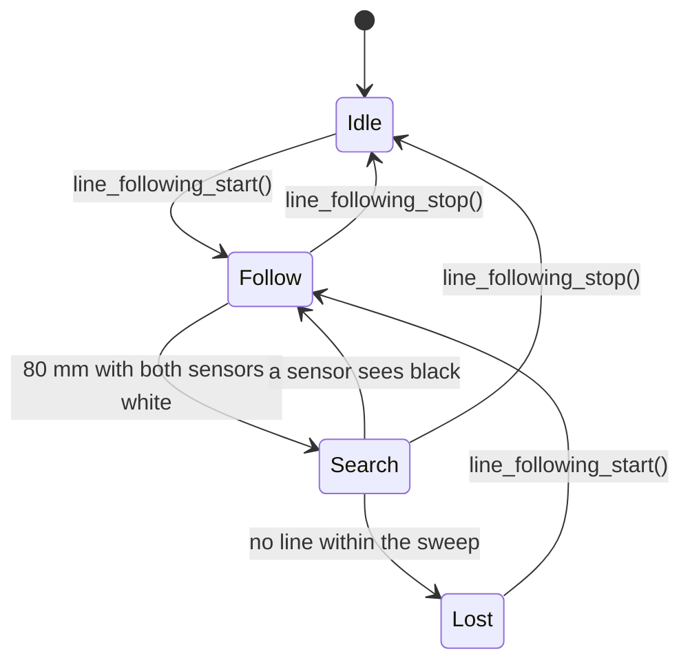
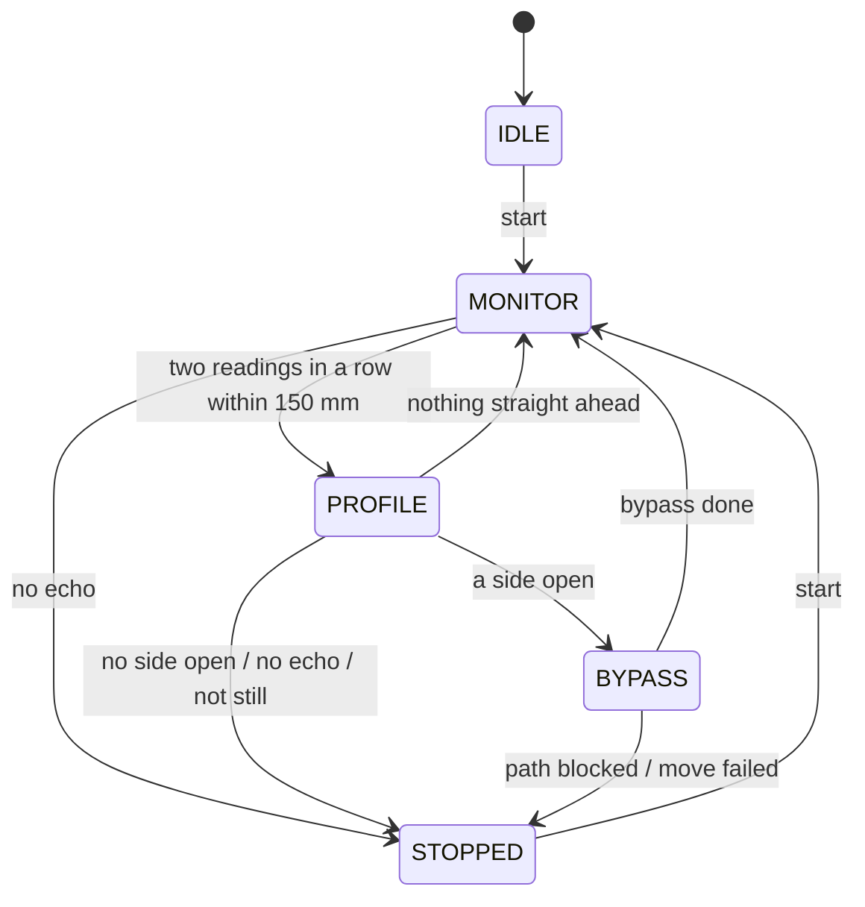
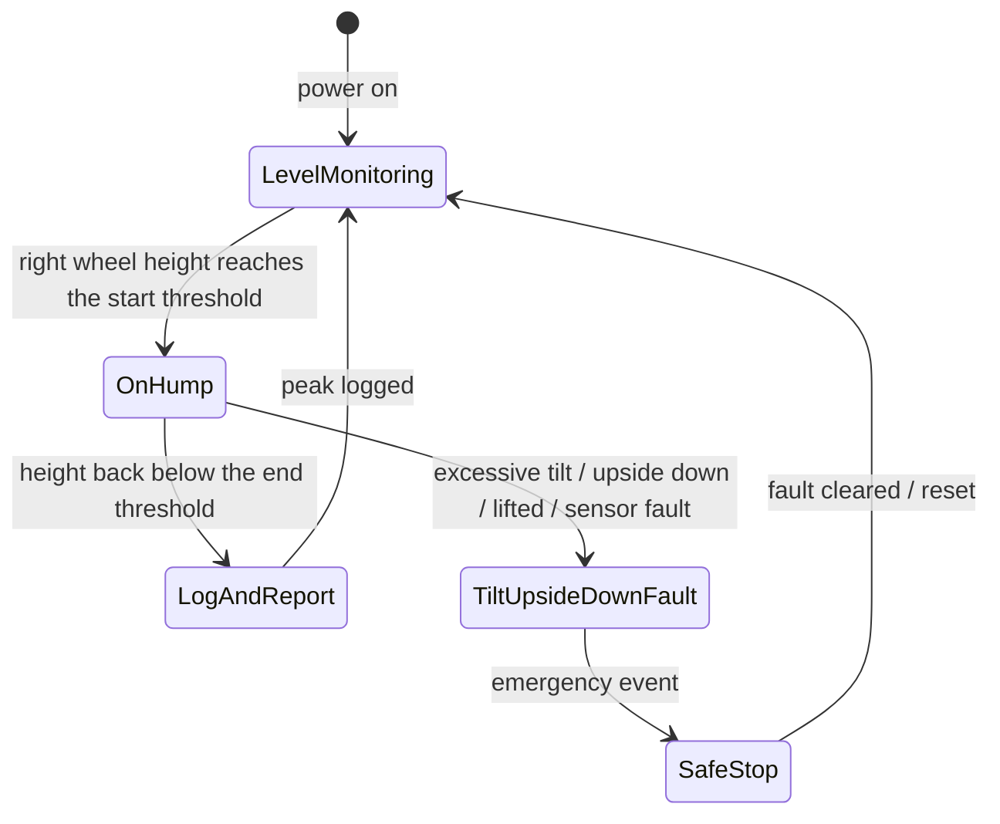

# System Architecture

Tasks, hardware ownership, interfaces and statecharts, starting from the Week 6 design review. Requirement IDs (FR/NFR/A) refer to [PROJECT_BRIEF.md](PROJECT_BRIEF.md#team-requirements). The exact functions behind each interface are in `TEAM.md` section 5.

## Design rules

Changing one means updating this document.

1. **Motors are driven only through the motion API.** Wheel Motion Control runs the PID and writes the motor PWM. Other tasks command it with `motion_control_*()` calls, and none drives a motor pin itself. The one exception: `motion_control_stop()` and `motion_control_latch()` brake both wheels at once from the calling task, so a stop never waits for the next motion step.
2. **Each hardware device has exactly one owning task.** Others get its data through an interface.
3. **Safety Monitor has the highest priority and can stop the car on its own**, bypassing the Vehicle Controller.
4. **Telemetry runs below everything else**, so a network delay can never hold up navigation or motor control.
5. **Encoder edges are captured by interrupt**, not by a periodic task.
6. **The ultrasonic scanner scans on request**, not every cycle.
7. **No unbounded queues and no runtime allocation in control paths** (NFR7).
8. **Integrate early.** Interfaces are tested before the subsystems behind them are finished.

## Layers

| Layer         | Contents                                                                     |
| ------------- | ---------------------------------------------------------------------------- |
| Sensing       | Line IR, barcode IR, wheel encoders, IMU, ultrasonic                         |
| Control       | Motion control, line following, obstacle avoidance, navigation logic, safety |
| Communication | Wi-Fi, MQTT, telemetry                                                       |

## Tasks

`P1` is the highest. The P-numbers give the order; the actual µT-Kernel priorities (a lower number runs first) are in the Priority column and in `TEAM.md` section 4. Priorities 1 to 4 belong to the kernel's own tasks (USB console 3, Wi-Fi 4).

| Pri | Priority | Task                            | Purpose                                                                     | Trigger                              | Buddy |
| --- | -------- | ------------------------------- | --------------------------------------------------------------------------- | ------------------------------------ | ----- |
| P1  | 5        | Safety Monitor                  | Latch a stop on an IMU fault or a wheel stall                                | Every 10 ms                          | All   |
| P2  | 6        | Wheel Motion Control            | Per-wheel PID, odometry, encoder-based moves and turns                      | Every 10 ms                          | 2     |
| P3  | 8        | Barcode Decoder                 | Decode the barcode IR samples and validate the letter                       | Every 10 ms                          | 3     |
| P4  | 9        | Line Following                  | Steer along the line, detect junctions, search for a lost line              | Every 10 ms                          | 3     |
| P5  | 10       | Vehicle Controller              | Mission state machine, GP20 button, junction turns                          | Every 10 ms                          | All   |
| P6  | 11       | Obstacle Avoidance              | Watch the range ahead, profile the obstacle, drive the bypass               | While started, ≥ 20 ms between steps | 5     |
| P7  | 12       | Ultrasonic Scan                 | Drive the servo and HC-SR04 through a forward reading or a profile scan     | On request                           | 5     |
| P8  | 18       | IMU and Terrain Monitor         | Pitch, roll, motion class, hump height, tilt / upside-down / lifted / sensor faults | Every 10 ms                          | 4     |
| P10 | 20       | Wi-Fi and MQTT Telemetry        | Telemetry and heartbeat                                                     | Every 200 ms                         | 1     |
| ISR | –        | GPIO interrupt (`app_main.c`)   | Count encoder edges; time the HC-SR04 echo                                  | GPIO edge                            | 2, 5  |

The periodic tasks are woken by cyclic handlers (`app_start_cyclic()`), so their periods are exact on the 10 ms kernel tick. Supervisor commands arrive in the kernel's Wi-Fi service task, which sets the command event flag (I12); the Telemetry task does not handle them. P9 is left free.

### Barcode acquisition

The ADC samples the barcode sensor (ADC0) at 2 ksample/s from start-up, paced by the ADC clock divider and moved by one DMA channel into a 256-sample (128 ms) ring that wraps by itself. Every 10 ms the task takes the samples written since its last read, about 20. A task that falls more than 128 ms behind loses the oldest samples. Bar widths are measured against encoder distance (I5), never against task wake-ups, so speed changes do not distort them.

At 150 mm/s and a 3 mm narrow bar this gives about 40 samples per narrow bar.

### Hardware ownership

| Hardware                             | Owner                                                |
| ------------------------------------ | ---------------------------------------------------- |
| Motor driver outputs (GP8 to GP11)   | Wheel Motion Control (design rule 1 for stops)       |
| Wheel encoders                       | GPIO interrupt, feeding Wheel Motion Control         |
| Left and right line IR sensors       | Line Following                                       |
| Barcode IR sensor (ADC0, DMA ch. 11) | Barcode Decoder                                      |
| GY-511 IMU (I2C0)                    | IMU and Terrain Monitor                              |
| Robo Pico buzzer (GP22)              | IMU and Terrain Monitor                              |
| HC-SR04 and SG90 servo               | Ultrasonic Scan                                      |
| GP20 button                          | Vehicle Controller (the avoidance bench in `TEST=1`) |
| Pico W radio and network stack       | The kernel's Wi-Fi service task                      |

Pin numbers are in [HARDWARE.md](HARDWARE.md#pin-map). The radio, lwIP and MQTT belong to the kernel's Wi-Fi service task on processor 1 (physical core 0). Peripheral owners are recorded in `TEAM.md` section 3.

## Interfaces

Not drawn: the Telemetry task reads every task's status for its payloads ([Telemetry](#telemetry)), and every task reports faults through the shared fault bitmask (`app_fault.h`).

| ID  | From → To                                                         | Carries                                                                                    |
| --- | ----------------------------------------------------------------- | ------------------------------------------------------------------------------------------ |
| I1  | Line Following ↔ Vehicle Controller; Obstacle Avoidance → Line Following | Start (with a speed) and stop one way; sensor bits, junction, searching and lost flags the other |
| I2  | Barcode Decoder → Vehicle Controller                              | Last validated command, validated and rejected counts, odometer at the barcode             |
| I3  | Vehicle Controller, Line Following, Obstacle Avoidance → Wheel Motion Control | Move a distance, turn an angle, drive at wheel speeds (expires after 200 ms unless renewed), stop; a new command replaces the running one |
| I4  | Wheel Motion Control → any task                                   | Motion status: `IDLE`, `RUNNING`, `COMPLETE`, `FAILED`, speeds, counts                     |
| I5  | Wheel Motion Control → Barcode Decoder, Line Following            | Odometer and heading; distance rolled up to now in µm                                      |
| I6  | Vehicle Controller ↔ Obstacle Avoidance                           | Start / cancel one way; state, bypass side and step, clearances the other                  |
| I7  | Obstacle Avoidance → Ultrasonic Scan                              | Scan request: `FORWARD` (one reading ahead) or `PROFILE` (coarse then fine sweep)          |
| I8  | Ultrasonic Scan → Obstacle Avoidance                              | Forward range and its time, obstacle profile                                               |
| I9  | IMU and Terrain Monitor → Vehicle Controller                      | Calibration done, highest hump of the run; tilt, upside-down, lifted and sensor faults as fault bits |
| I11 | Vehicle Controller → Safety Monitor → Wheel Motion Control        | Stop with a cause, clear; the motion latch, which refuses every command while set          |
| I12 | Wi-Fi service → Vehicle Controller; Telemetry → Wi-Fi service     | `START` / `STOP` / `RESET` from the supervisor; telemetry, scan, motion and heartbeat to it |

Notes:

- Each interface except I12 is a set of function calls that copy a record under the provider's mutex, so they are safe from any task on either core. I12 uses a message buffer (telemetry out) and an event flag (commands in).
- Only one task steers at a time: the Vehicle Controller starts line following and avoidance, avoidance stops line following when it takes over (I1), and the controller restarts it once avoidance is back to watching ([VEHICLE_CONTROLLER.md](VEHICLE_CONTROLLER.md#hand-over-to-avoidance)).
- Collision risk belongs to Obstacle Avoidance, which brakes on the second forward reading in a row within 150 mm. It reads the range only while the car follows the line or drives straight in a bypass: nothing checks it during turns (avoidance's bypass turns, the controller's junction turns, the line follower's lost-line pivot). The Safety Monitor does not read I8: a range backstop could never act before avoidance, which brakes on the same reading, and only avoidance requests readings.
- The Safety Monitor latches a stop on an IMU fault bit or motion `FAILED`. The Vehicle Controller latches it too for each of its own stops, including the supervisor's `STOP`. While the latch is set, motion control refuses every command, so a request issued before the stop can never move the car (FR11).
- The supervisor may only start, stop and reset. It never steers or sets speed (FR1).

## System statechart

The Vehicle Controller's states ([VEHICLE_CONTROLLER.md](VEHICLE_CONTROLLER.md#states) has every transition and its cause):

AVOID and TURN also drop to SAFE_STOP on Stop, a safety latch or a failure of their own (for AVOID, no safe path); INIT and READY drop to it on a safety latch, READY also on the supervisor's `STOP`.

| State     | What happens                                                                                                  |
| --------- | ------------------------------------------------------------------------------------------------------------- |
| INIT      | Tasks created and sensors set up by `usermain()`; wait for the IMU's calibration                    |
| READY     | Car stopped. Wait for Start (GP20 or the supervisor); telemetry and heartbeat keep running                   |
| FOLLOW    | Follow the line and watch for obstacles; a validated barcode becomes the pending command; the line follower searches for a lost line by itself |
| AVOID     | Obstacle Avoidance profiles the obstacle, plans and drives the bypass, and ends stopped on the original line |
| TURN      | At the junction after a barcode: roll forward onto it, turn left, right, straight on or U-turn, follow again |
| SAFE_STOP | Motors braked and latched. Print the highest hump of the run. Wait for a reset                              |

Humps are tracked by the IMU task in every state, so there is no hump state. Safe Stop is latched: leaving it needs the fault to clear and a reset, then a new Start (FR11). The courses run back to back with no finish marker, so a course ends on Stop: Safe Stop brakes the motors and reports the run's highest hump (FR12).

## Subsystem statecharts

### Line following and barcode navigation

Tasks: Line Following, Barcode Decoder, Vehicle Controller, Wheel Motion Control.

- **Follow** reads the left and right IR sensors every 10 ms and steers towards the sensor that sees black. Both black for 6 samples is a junction, driven straight over.
- **Search** pivots towards the side the line was last seen, then the other way. **Lost** brakes and sets `b_lost`; the Vehicle Controller takes a safe stop.
- The **Barcode Decoder** samples all the time. A barcode ends at a white run over 30 mm; it is decoded as Code 39 in either direction and validated, or rejected and counted. An unvalidated barcode is never acted on.
- The Vehicle Controller acts on the latest validated barcode at the next junction (TURN), with encoder-based motion, then starts line following again.

Details: [LINE_FOLLOWING.md](LINE_FOLLOWING.md#how-it-works).

### Obstacle detection and avoidance

Tasks: Ultrasonic Scan, Obstacle Avoidance, Vehicle Controller, Wheel Motion Control.

`cancel` returns any state to IDLE, braking the car if avoidance was driving it.

- **Monitor** asks for forward readings while the car follows the line.
- **Profile** stops line following, brakes, then asks for a profile scan with the car still: a coarse sweep every 15°, then a fine sweep every 5° outward from straight ahead while the rays are blocked. The result is the obstacle's edges, width and closest point, and the clearance 45° left and right.
- **Bypass** picks the more open side with at least 250 mm (left on a tie), checks along the first diagonal that the path is clear (if not, trying the other side once if the scan found it open), then drives seven encoder-based steps around the obstacle back to the original line and heading. Each straight step watches the range ahead and stops within 150 mm.
- Reverse is disabled: nothing verifies clearance behind the car. No safe forward route means Safe Stop (FR7).

Details: [OBSTACLE_AVOIDANCE.md](OBSTACLE_AVOIDANCE.md#how-it-works).

### IMU terrain monitoring

Tasks: IMU and Terrain Monitor, Vehicle Controller, Safety Monitor.

Excessive tilt, being upside down, being lifted and the sensor fault are checked in every monitoring state, not only the one drawn.

- **Level Monitoring** calibrates the start-surface baseline, then tracks filtered pitch, roll and acceleration.
- Humps pass under the right wheel only; the left side carries the barcode sensors. The car rests on three points (two drive wheels and a caster), so it tips about the line from the left wheel to the caster, and the right wheel's height is the track width × sin(roll). No encoder travel is needed (FR5).
- **On Hump** tracks the highest height until the wheel is back on flat ground.
- **Log and Report** raises the highest hump of the run if this one was higher. Telemetry and the Vehicle Controller's safe stop read it; it resets at each Start.
- The task also publishes one current motion class, highest first: climbing or descending a hump, accelerating or braking, steady. Steady covers both parked and cruising: the accelerometer cannot tell them apart.
- Excessive tilt is pitch or roll beyond 25° for 500 ms. Upside down is calibrated Z below 0 mg (over 90° from the start surface) for 200 ms: lifting the car and turning it over ends a demo run, however fast it is lifted. Tilt alone cannot see this, as pitch and roll come from X and Y and read near 0 again once the car is fully inverted. Driving never takes Z below 0: that needs a 1 g downward push held for 200 ms. While any IMU fault (tilt, upside down or lifted) is set, a hump in progress is dropped and none are tracked, so picking the car up and turning it over at the end of a run is not measured as a hump. Both latch, and the Safety Monitor stops the motors.
- Lifted is Z over 1.3 g for 50 ms, the push of a quick lift; knocks from humps and the ramp edge must stay shorter (S4-U24), and a slow lift is left to the upside-down check. It stops the motors too, but is not latched: it clears when Z has settled and its 1 s beep has ended, so a car picked up after calibration needs one Start/Stop press, not a reset. There is no impact detection: the course replaced collision detection with this lift stop.
- The sensor fault is 5 failed reads in a row (50 ms: the GY-511 is unplugged, and without it none of the checks above can stop the car), one read that timed out (the bus hung: the kernel I2C driver gives up after 1 s), or all three axes unchanged for 50 readings in a row (500 ms: it answers but has stopped sampling, as after a dip in its supply; a working one moves by a few mg even at rest). No read is made while it is set. It stays set until a Reset (GP20 in Safe Stop, or the supervisor's RESET), which clears it and has the task start again as at power-on: the sensor is started again (one plugged back in is in power-down) and calibrated again. The controller waits for that calibration, and a sensor still out or frozen faults again first, so the car cannot be started without a working sensor. The new baseline is the surface the car stands on at the Reset, so it should be flat and still, as at power-on.
- A start threshold that must hold for a minimum time, above a lower end threshold, on low-pass filtered data, rejects vibration and jolts. Turning pushes sideways on the sensor and looks like roll, so cornering is the main source of false humps (A4).

The GY-511 has no gyroscope, so everything here comes from the accelerometer.

## Telemetry

Topics and payloads are in [TELEMETRY.md](TELEMETRY.md). The brief expects telemetry to cover at least:

- current robot state
- motor speed and encoder counts
- line sensor status
- barcode detected
- hump measurements
- obstacle scan results
- distance travelled
- heartbeat and connection status

Every 200 ms the Telemetry task reads each subsystem's status and publishes the telemetry and motion payloads; it publishes a scan payload after each profile that leads to a bypass or finds no side open, and a heartbeat every second. Payloads are compact binary, per [DATA_REPRESENTATION.md](DATA_REPRESENTATION.md). Telemetry bandwidth is measured under NFR7.

The kernel port ships an MQTT client (`lib/liblwip/sysdepend/pico_rp2040/mqtt_utk.c`, built with `NET=lwip MQTT=1`) that runs inside the kernel's Wi-Fi service task. The Telemetry task does not call it directly: it hands messages to the service through a message buffer, as described in `TEAM.md` section 3.

## Values set by measurement

The design does not fix these. They come from tests on the real car and track, and belong with the owning subsystem's calibration data (NFR8).

| Value | Established by |
| --- | --- |
| Task periods and priorities | Execution-time and timing measurements |
| Barcode sampling rate | Measured bar width and car speed |
| PID constants | Experimental tuning |
| IR thresholds and barcode timing | Calibration on the real track |
| Hump-height estimation error | Humps of known height (A4) |
| Ultrasonic profile error | Objects at known distance and width (A5) |
