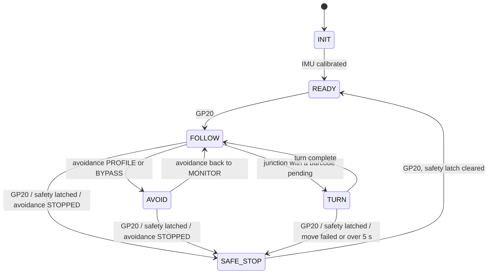

# Vehicle Controller (shared)

The mission state machine and the arbiter of normal motion (FR1, FR8). It owns no hardware except the GP20 Start/Stop button, and drives the car only through the other subsystems' APIs.

| File (`app_program/shared/`) | Contents                                            |
| ---------------------------- | --------------------------------------------------- |
| `vehicle_controller.c/.h`    | Controller task `vc`, priority 10, every 10 ms, any core |

`usermain()` starts it in normal builds only: `TEST=1` keeps GP20 and GP21 for the subsystem bench sequences.

## States



| State     | What happens                                                                                                                                                                                             |
| --------- | -------------------------------------------------------------------------------------------------------------------------------------------------------------------------------------------------------- |
| INIT      | Waits for the IMU's start-up calibration (`s4_get_tilt()`, `cal`)                                                                                                                                         |
| READY     | Car stopped. Barcodes read now are ignored                                                                                                                                                               |
| FOLLOW    | `line_following_start(200)` and `obstacle_avoidance_start()`. A newly validated barcode becomes the pending command; a later one replaces it                                                              |
| AVOID     | Hands off: avoidance has already stopped line following and drives the car until it is back to `MONITOR`, stopped on the original line                                                                   |
| TURN      | Stops line following, cancels avoidance, rolls forward `VC_AXLE_MM` onto the junction, then turns for the pending command: A left 90°, B right 90°, C none, D left 180°. Each move must finish in 5 s |
| SAFE_STOP | Entered whenever the Safety Monitor is latched, from any state; the controller's own stops latch it too. Cancels avoidance and stops line following (which brakes). GP20 clears the latch and returns to READY, and a second press starts again (FR11). An IMU fault stays latched until reset, so the car stays here |

A barcode or junction seen during TURN or AVOID is taken once FOLLOW resumes. A junction is acted on at its first sample (`b_junction` rising), and only with a command pending.

These system states (ARCHITECTURE.md) have no state of their own here:

- **Hump Monitoring:** Subsystem 4 tracks humps by itself while the car follows the line. The run's highest hump is printed on every safe stop.
- **Line Recovery** and **Line Lost:** a bypass ends stopped on the original line, so FOLLOW simply restarts line following. With two sensors straddling the line, both white means centred or lost, so a lost line cannot be detected.
- **Mission Complete:** needs a course-finish event (FR12); until one is defined, a junction with nothing pending is driven straight over.

## GP20

One button, low when pressed, sampled every 10 ms. A press counts after 50 ms released, which ignores bounce.

| State                    | Press                      |
| ------------------------ | -------------------------- |
| READY                    | Start: FOLLOW              |
| FOLLOW, AVOID, TURN      | Stop: SAFE_STOP            |
| SAFE_STOP                | Reset to READY, if `safety_monitor_clear()` succeeds |
| INIT                     | Nothing                    |

## Calibration

Constants are at the top of `vehicle_controller.c`.

| Constant         | Default | Set it to                                                                                |
| ---------------- | ------- | ---------------------------------------------------------------------------------------- |
| `VC_AXLE_MM`     | 110     | Distance from the line sensors back to the wheel axle, so turns pivot over the junction  |
| `VC_SPEED_MM_S`  | 200     | Line following speed, 1 to 500; the barcode decoder is tuned for about 200               |
| `VC_MOVE_CYCLES` | 500     | Limit on each junction move, in 10 ms cycles                                              |

## Console

Every state change prints its cause, for example:

```
[vc] READY -> FOLLOW: GP20
[vc] barcode 1 pending
[vc] FOLLOW -> TURN: junction
[vc] TURN -> FOLLOW: turn done
[vc] FOLLOW -> SAFE_STOP: avoidance stopped
[safety] stop, cause 0x8
[vc] max hump 12 mm
```

## Hand-over to avoidance

Line following and avoidance both command the motors, so only one may run at a time. Avoidance stops line following itself when it sees an obstacle (`line_following_stop()`, which brakes), so the line follower cannot drive again during the bypass and the controller never brakes under avoidance. The controller restarts line following once avoidance is back to `MONITOR`.
