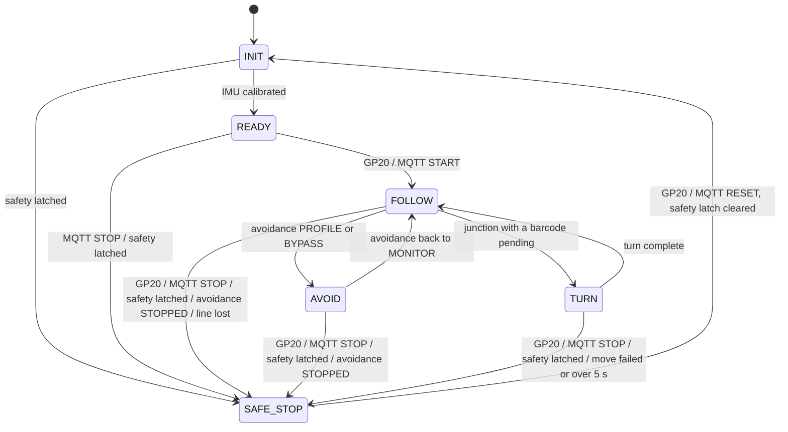

# Vehicle Controller (shared)

The mission state machine and the arbiter of normal motion (FR1, FR8). It owns no hardware except the GP20 Start/Stop button, and drives the car only through the other subsystems' APIs. The supervisor can also start, stop and reset it over MQTT.

| File (`app_program/shared/`) | Contents                                            |
| ---------------------------- | --------------------------------------------------- |
| `vehicle_controller.c/.h`    | Controller task `vc`, priority 10, every 10 ms, any core |

`usermain()` starts it in normal builds only: `TEST=1` keeps GP20 and GP21 for the subsystem bench sequences.

## States



| State     | What happens                                                                                                                                                                                             |
| --------- | -------------------------------------------------------------------------------------------------------------------------------------------------------------------------------------------------------- |
| INIT      | Waits for the IMU's start-up calibration (`s4_get_tilt()`, `cal`)                                                                                                                                         |
| READY     | Car stopped. Barcodes read now are ignored                                                                                                                                                               |
| FOLLOW    | `line_following_start(VC_SPEED_MM_S)` and `obstacle_avoidance_start()`. A newly validated barcode becomes the pending command; a later one replaces it. While the line follower pivots to find a lost line (`b_searching`), avoidance is cancelled, so the sweep is not taken for an obstacle ahead, and started again once the line is found                                                              |
| AVOID     | Hands off: avoidance has already stopped line following and drives the car until it is back to `MONITOR`, stopped on the original line                                                                   |
| TURN      | Stops line following, cancels avoidance, rolls forward `VC_AXLE_MM` onto the junction, then turns for the pending command: A or Z left 90°, B right 90°, C none, D left 180°. Each move must finish in 5 s |
| SAFE_STOP | Entered whenever the Safety Monitor is latched, from any state; the controller's own stops latch it too. Cancels avoidance and stops line following (which brakes). GP20 clears the latch and returns to INIT, which moves on to READY as soon as the IMU is calibrated, so a stop taken before calibration cannot skip it; a second press starts again (FR11). Tilt, upside-down and IMU sensor faults stay latched until reset, so the car stays here; a lifted fault clears about 1 s after the lift, so a car picked up after calibration needs one press to clear before the press that starts it |

A barcode validated during TURN or AVOID becomes the pending command once FOLLOW resumes. A junction is acted on at its first sample (`b_junction` rising), and only in FOLLOW with a command pending: one crossed during a bypass or a turn is not taken later, unless, after a bypass, the sensors are still on it when FOLLOW resumes.

Some parts of the mission have no state of their own:

- **Humps:** Subsystem 4 tracks humps by itself in every state. Each Start (READY to FOLLOW) resets the highest hump, so it covers the current run, and every safe stop prints it.
- **Line recovery:** a bypass ends stopped on the original line, so FOLLOW simply restarts line following. The line follower searches for a lost line by itself ([LINE_FOLLOWING.md](LINE_FOLLOWING.md#how-it-works)); if its search fails it sets `b_lost` and the controller takes a safe stop (`line lost`).
- **End of a course:** the courses have no finish marker, so a course ends with a GP20 Stop or the supervisor's STOP, and SAFE_STOP prints the run's highest hump (FR12). A junction with nothing pending is driven straight over.

## GP20

One button, low when pressed, sampled every 10 ms. A press counts after 50 ms released, which ignores bounce.

| State                    | Press                      |
| ------------------------ | -------------------------- |
| READY                    | Start: FOLLOW              |
| FOLLOW, AVOID, TURN      | Stop: SAFE_STOP            |
| SAFE_STOP                | Reset to INIT (READY once calibrated), if `safety_monitor_clear()` succeeds |
| INIT                     | Nothing                    |

## MQTT commands

The supervisor's `cmd` byte ([TELEMETRY.md](TELEMETRY.md#cmd-8-bits)) reaches the controller as bits of the event flag `gh_s1_command_flag`, which it takes and clears once per cycle. The flag exists in every build; only a `NET=lwip MQTT=1` build sets it.

| Command | Accepted in                 | Does                                                                         |
| ------- | --------------------------- | ---------------------------------------------------------------------------- |
| START   | READY                       | What a GP20 press does there: FOLLOW                                         |
| STOP    | READY, FOLLOW, AVOID, TURN  | SAFE_STOP, latching the Safety Monitor like the controller's other stops     |
| RESET   | SAFE_STOP                   | What a GP20 press does there: INIT (READY once calibrated), if `safety_monitor_clear()` succeeds |

A command in any other state is dropped, not kept for later. STOP is refused in INIT because nothing moves yet, and a stop there would let RESET skip the IMU calibration. STOP is taken first, so a byte or a cycle that carries STOP with START only stops. A stop the controller has already decided on in that cycle (safety latched, GP20, avoidance stopped, line lost) is taken before any command. No command steers or sets a speed.

## Calibration

Constants are at the top of `vehicle_controller.c`.

| Constant         | Default | Set it to                                                                                |
| ---------------- | ------- | ---------------------------------------------------------------------------------------- |
| `VC_AXLE_MM`     | 115     | Distance from the line sensors back to the wheel axle, so turns pivot over the junction  |
| `VC_SPEED_MM_S`  | 150     | Line following speed, 1 to 500                                                           |
| `VC_MOVE_CYCLES` | 500     | Limit on each junction move, in 10 ms cycles                                              |

## Console

Every state change prints its cause, for example:

```
[vc] READY -> FOLLOW: GP20
[vc] barcode 1 pending
[vc] FOLLOW -> TURN: junction
[vc] TURN -> FOLLOW: turn done
[vc] FOLLOW -> SAFE_STOP: avoidance stopped
[safety] stop, cause 0x8
[vc] max hump 12 mm
```

A supervisor command that is acted on is its own cause: `MQTT START`, `MQTT STOP` or `MQTT RESET` in place of `GP20`.

## Hand-over to avoidance

Line following and avoidance both command the motors, so only one may run at a time. Avoidance stops line following itself when it sees an obstacle (`line_following_stop()`, which brakes), so the line follower cannot drive again during the bypass and the controller never brakes under avoidance. The controller restarts line following once avoidance is back to `MONITOR`.
